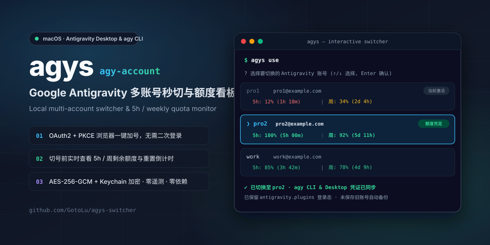

# agys (agy-account) -- Google Antigravity Multi-Account Switcher & Quota Monitor

<p align="center">
  
</p>

<p align="center">
  <a href="README.md">简体中文</a> · English · <a href="CHANGELOG.md">Changelog</a> · <a href="SECURITY.md">Security</a> · <a href="PRIVACY.md">Privacy</a>
</p>

**Switch between multiple Google AI Pro accounts for Google Antigravity Desktop and `agy` CLI in seconds -- without signing out and back in.** `agys` (`agy-account`) is a zero-runtime-dependency, local-first CLI tool for **macOS** written in TypeScript / Node.js.

- **Check remaining quota before switching**: On-demand **5-hour (5h)** and **Weekly** remaining quota with reset countdowns;
- **One-time OAuth setup**: Built-in Google OAuth2 + PKCE browser flow writes official `go-keyring-base64:` macOS Keychain credentials directly;
- **Local-first & zero telemetry**: Encrypted snapshots (`AES-256-GCM`, `0600` permissions) with master key stored in macOS Keychain.

## Quick Install (30 Seconds)

> **Requirements**: **macOS** only, **Node.js >= 22.0.0**.

### One-line Installer

```bash
curl -fsSL https://raw.githubusercontent.com/GotoLu/agys-switcher/main/scripts/install.sh | bash
```

You can inspect [`scripts/install.sh`](scripts/install.sh) before running it.

### Install from Source

```bash
git clone https://github.com/GotoLu/agys-switcher.git
cd agys-switcher
npm install
npm run build
npm link
```

Once installed, run `agys` (or `agy-account`) from any terminal directory.

## Key Features

- **Google OAuth2 + PKCE Login**: Run `agys add` to authenticate in your browser, auto-detect the email address, and create a ready-to-switch Keychain snapshot without a second login.
- **On-Demand 5h & Weekly Quota Monitor**: Inspect real-time remaining quotas and reset countdowns in `agys ls`, `agys quota`, and `agys use`, with automatic OAuth token refresh.
- **Interactive Terminal Menu**: Launch `agys` with no arguments for a persistent TTY menu (`↑`/`↓` or `j`/`k` to navigate, `Esc`/`q` to go back).
- **Desktop + CLI Sync & Plugin Protection**: Keeps `agy` CLI and Antigravity Desktop in sync (`--restart` waits for the previous process to exit cleanly before relaunching) while preserving `antigravity.plugins` (such as Google Drive / Docs) unless the target snapshot explicitly contains plugin entries.
- **Auto-Backup Safety Net**: Automatically backs up any unsaved active session as `_auto_backup` before switching accounts.
- **AES-256-GCM Encrypted Vault**: Snapshots live in `~/.config/agy-account/` (`0700` dir / `0600` files) with the encryption key managed by macOS Keychain.

## Commands

```bash
# Open interactive menu
agys

# Add a new account via Google OAuth2 browser flow
agys add
agys add pro2 --email your2@example.com

# Switch account (interactive list with 5h/weekly quota, or switch directly)
agys use
agys use pro2 --restart
agys use -

# Snapshot the currently logged-in account
agys save
agys save pro1 --email your@example.com

# List accounts and inspect quotas
agys ls
agys ls --no-quota
agys quota
agys current

# Inspect local Antigravity credential paths (redacted, never prints raw tokens)
agys inspect

# Remove a saved snapshot
agys rm pro1
```

## Security & Scope

- **Zero Telemetry**: Communicates only with official Google OAuth and Cloud Code quota endpoints when explicitly triggered by the user.
- **Manual Switching Only**: Designed for manual switching across personal subscriptions -- no background polling or request proxying.

## Development

```bash
npm install
npm run typecheck
npm run build
npm test
```

---

[Privacy Policy](PRIVACY.md) · [Security Policy](SECURITY.md) · [Changelog](CHANGELOG.md) · [MIT License](LICENSE)
