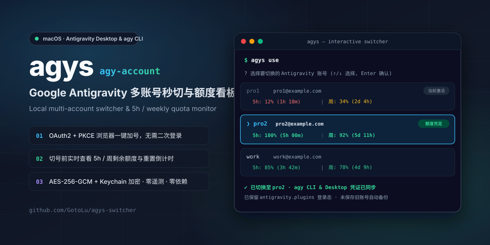

# agys (agy-account) -- Google Antigravity 多账号切换器与额度看板

<p align="center">
  
</p>

<p align="center">
  简体中文 · <a href="README.en.md">English</a> · <a href="CHANGELOG.md">Changelog</a> · <a href="SECURITY.md">Security</a> · <a href="PRIVACY.md">Privacy</a>
</p>

**额度见底时，秒切下一个 Google AI Pro 账号，不再反复登出登录。** `agys`（包名 `agy-account`）是面向 **macOS** 的 **Google Antigravity Desktop** 与 **`agy` CLI** 本地多账号凭证快照与切换工具，采用 TypeScript / Node.js 零运行时依赖实现。

- **切号前先看余量**：按需查询每个账号的 **5 小时（5h）** 与 **周（Weekly）** 剩余额度及重置倒计时；
- **一次授权即可秒切**：内置 Google OAuth2 + PKCE 浏览器登录，直接写入兼容官方格式的 macOS Keychain 凭证；
- **纯本地零遥测**：快照使用 `AES-256-GCM` 加密存于本机（权限 `0600`），主密钥托管于 macOS Keychain，不向任何第三方发送数据。

## 30 秒体验

> **系统要求**：仅支持 **macOS**，需要 **Node.js >= 22.0.0**。

### 一键安装（推荐）

```bash
curl -fsSL https://raw.githubusercontent.com/GotoLu/agys-switcher/main/scripts/install.sh | bash
```

脚本会检查 macOS 与 Node.js 版本、克隆仓库到 `~/.local/share/agys`、执行编译并完成全局 `npm link`。执行前可先查看 [`scripts/install.sh`](scripts/install.sh)。

### 手动源码安装

```bash
git clone https://github.com/GotoLu/agys-switcher.git
cd agys-switcher
npm install
npm run build
npm link
```

安装完成后，在任意终端目录均可直接运行 `agys`（或 `agy-account`）。

## 核心特性

- **OAuth2 + PKCE 一键添加账号**：运行 `agys add` 拉起浏览器完成 Google 授权，自动识别邮箱并生成兼容官方 `go-keyring-base64:` 格式的 Keychain 登录态，无需二次登录即可直接切换。
- **实时 5h / 周额度查询**：运行 `agys ls`、`agys quota` 或 `agys use` 时按需拉取 Google Cloud Code 5 小时与周剩余额度及重置倒计时，并在 OAuth Token 过期时自动刷新。
- **驻留式终端交互菜单**：直接运行 `agys` 进入循环交互菜单，支持方向键 `↑`/`↓`（或 `j`/`k`）选择、`Esc`/`q` 返回上一级，零外部终端依赖。
- **双端联动与插件登录态保护**：切换时同步更新 `agy` CLI 与 Antigravity Desktop（`--restart` 会等待旧进程彻底退出后再拉起桌面端），并按服务粒度隔离 `gemini` 与 `antigravity.plugins`，保护 Google Drive / Docs 等插件登录态不被误删。
- **防误覆盖自动备份**：执行 `agys use` 覆盖当前本机登录态前自动校验，未保存的新账号会自动备份为 `_auto_backup`。
- **AES-256-GCM 本地加密存储**：所有快照加密存放在 `~/.config/agy-account/`（目录 `0700`、文件 `0600`），加密主密钥由 macOS Keychain 托管。

## 常用命令

| 命令 | 说明 |
| --- | --- |
| `agys` | 进入循环交互式主菜单（支持 `↑`/`↓` 或 `j`/`k` 移动，`Esc`/`q` 返回或退出） |
| `agys add [alias] [--email]` | 发起 Google OAuth2 浏览器授权并添加新账号 |
| `agys use [alias\|-] [--restart \| --no-restart]` | 切换账号（不填别名则交互选择并展示 5h/周额度；`-` 切回上一个账号） |
| `agys save [alias] [--email]` | 将当前本机已登录的 Antigravity 账号加密保存为别名 |
| `agys ls [--no-quota]` | 列出所有已保存账号及实时 5h/周额度（`--no-quota` 可跳过联网查询） |
| `agys quota` | 查看所有已绑定 OAuth 账号的 5 小时与周额度详情 |
| `agys current` | 显示当前激活账号 |
| `agys inspect` | 检查本机 Antigravity 凭证存储位置与登录状态摘要（不输出明文密钥） |
| `agys rm [alias] [-y\|--yes]` | 删除指定账号快照 |

### 典型使用流程

```bash
# 1. 保存当前已登录账号，或直接通过浏览器添加多个 Google 账号
agys save pro1
agys add pro2

# 2. 查看各账号 5 小时与周剩余额度
agys ls

# 3. 切换到额度充足的账号并自动重启 Antigravity Desktop
agys use pro2 --restart

# 4. 快速切回上一个账号
agys use -
```

## 安全与使用边界

- **纯本地运行**：除用户主动触发的 Google 官方 OAuth 授权与 Cloud Code 额度查询外，不向任何第三方服务器发送数据。
- **人工按需切换**：仅用于个人独立订阅账号的人工显式切换与额度查看，不提供后台自动轮询、高频刷额度或并发代理功能。
- **密钥脱敏**：所有日志、报错与 `agys inspect` 输出均不打印真实 OAuth Token 或完整 Keychain 密钥。

## 开发与验证

```bash
npm install
npm run typecheck
npm run build
npm test
```

---

[隐私说明](PRIVACY.md) · [安全策略](SECURITY.md) · [更新日志](CHANGELOG.md) · [MIT License](LICENSE)
